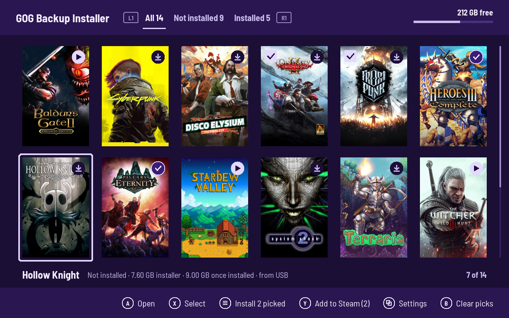
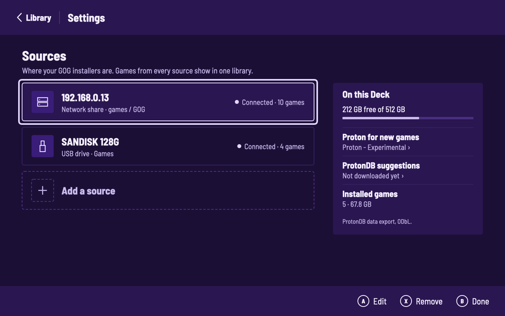
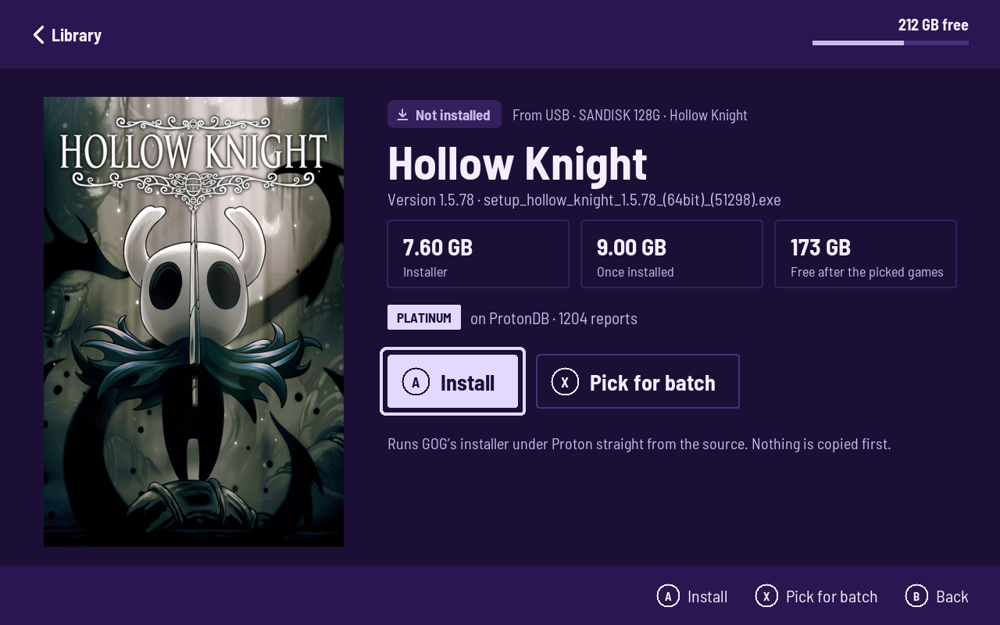
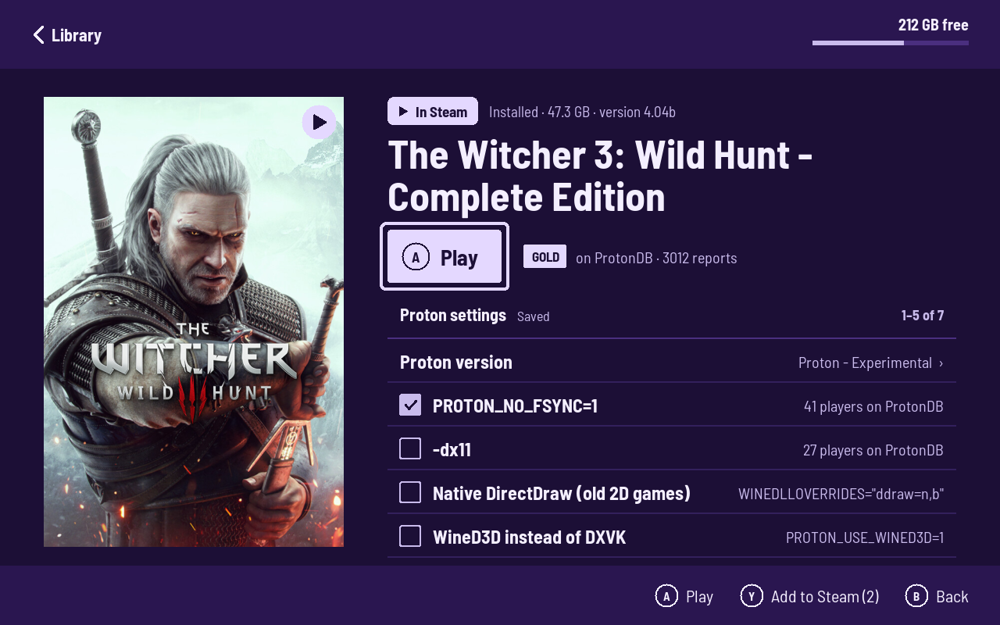
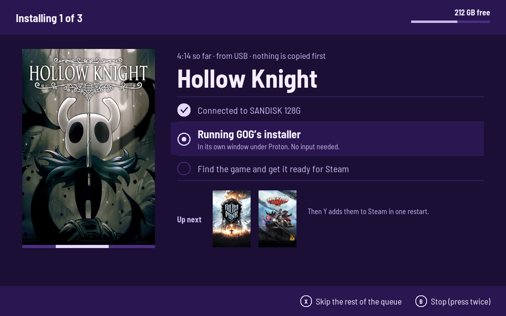

# GOG Backup Installer for Steam Deck

Installs your GOG installer backups on the Steam Deck and adds the games to Steam.



## Install

```bash
./install.sh
```

Then add the app to Steam (this restarts Steam):

```bash
ssh deck@steamdeck.local 'systemd-run --user --collect python3 ~/.local/share/gog-installer/gog_installer.py --apply-steam'
```

## Sources

Keep one folder per game, with its `setup_*.exe` and `.bin` files inside.

Press **View** (or **Start**) in the app for Settings, then **Add a source**:

- **Network share:** enter the server, then pick a guest SMB share and folder with the gamepad.
- **USB drive or SD card:** pick the drive and folder with the gamepad.



## Use

The library is a grid of covers. A badge on each says where it stands: not installed, installed, or in Steam.
**L1** and **R1** switch between All, Not installed and Installed.

- **A** opens a game. On a game that isn't installed, **A** installs it.
- **X** picks several games; **Start** installs them one after another.
- **Y** adds installed games to Steam. Steam restarts once.
- On an installed game, **A** plays it through Steam. Below are its Proton version, fixes, and a log for the next launch; **Y** applies changes.
- Everything can also be tapped.

Covers come from Steam and GOG and are kept in `~/.cache/gog-installer/covers`. Until a cover is there, the game shows as a coloured tile with its title.

<p>
  
  
</p>



## Credits

ProtonDB suggestions use the ProtonDB data export, [github.com/bdefore/protondb-data](https://github.com/bdefore/protondb-data) (ODbL).
